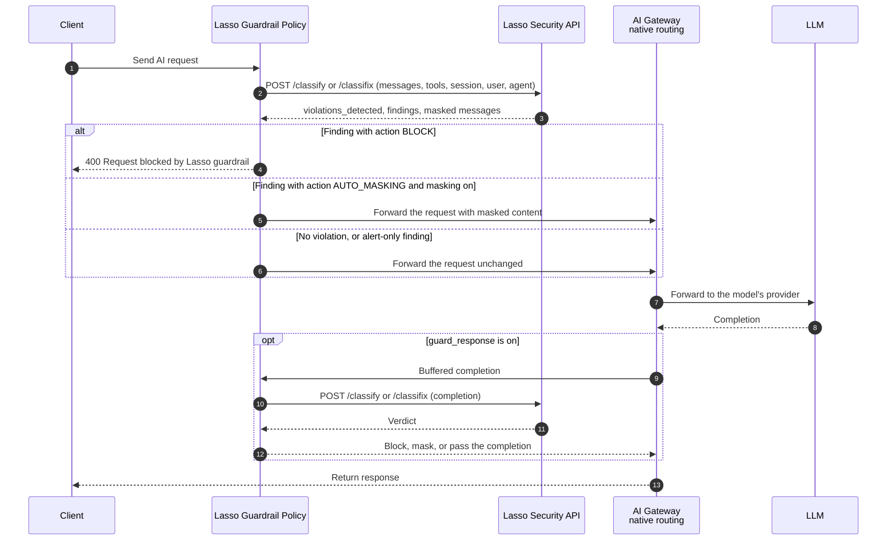

# Lasso Security AI Guardrail Policy

The Lasso Security AI Guardrail Policy sends every prompt, and optionally every completion, that passes through an [AI Model](/ai-gateway/entities/ai-model/) to [Lasso Security](https://www.lasso.security) for classification.
When Lasso flags a violation, the policy blocks the request or masks the sensitive text in place, before the LLM or the client ever sees it.

It's registered as a **streaming [custom policy](/ai-gateway/custom-policies/)** from a `schema.lua` and a `handler.lua` file.
Konnect stores both files and streams them to every data plane, so the data plane runs the stock AI Gateway image.

Benefits of using the Lasso Security AI Guardrail Policy:

- **Prompt injection and jailbreak detection**: Lasso classifies each prompt before it reaches the model, and the policy rejects it with a configurable status code.
- **Data leakage prevention**: With `masking` on, PII and secrets are redacted in the request or response body, so the conversation continues with the sensitive values removed.
- **Full conversation context**: The policy forwards the structured `messages` and `tools` arrays, not concatenated text, so Lasso sees roles, tool definitions, and the whole conversation.
- **Both directions**: Prompts are scanned in the access phase. Completions can be scanned in the response phase.
- **Per-user and per-agent visibility**: The policy forwards a user ID, a session ID, and an agent ID and name, so the Lasso console groups findings by user, conversation, and agent.
- **Fail open by default**: If Lasso is slow or unavailable, traffic keeps flowing. An invalid API key always surfaces as an error, so fail-open can't silently disable the guardrail.

## How it works

The policy runs in the access phase at priority `772` to scan the prompt and, when `guard_response` is on, in the response phase to scan the completion.
For each phase it builds a classification request from the OpenAI-format body and posts it to the Lasso API: `/classify` to detect, or `/classifix` to detect and mask.



The verdict comes from the actions configured in the Lasso console for each detector:

#### `BLOCK`
Policy behavior: Rejects the request or response with `block_status_code` and `block_message`. The `reason` field names the detector.

#### `AUTO_MASKING`
Policy behavior: With `masking: true`, rewrites the body with the masked text. With `masking: false`, the request passes and the finding is recorded in Lasso.

#### `USER_ALERT`, `ADMIN_ALERT`
Policy behavior: The request passes and the finding is recorded in Lasso.

A block response looks like this:

```json
{"message": "Request blocked by Lasso guardrail", "reason": "jailbreak/prompt_injection (HIGH)"}
```

### What is sent to Lasso

Each classification request carries:

- `messages`: The role and text of every message. Multimodal content is flattened to its text parts.
- `tools`: The tool definitions from the request, when present.
- `messageType`: `PROMPT` in the access phase, `COMPLETION` in the response phase.
- `sessionId`, `userId`, `agentId`, `agentName`: Identity fields, described below.
- `source.type`: `kong`, so the Lasso console shows which integration reported the traffic.

### Session and identity

The policy reads identity from request headers. All header names are configurable.

#### `x-session-id` (`session_header`)
Payload field: `sessionId`
Fallback: A generated ULID, shared by the prompt and completion of one request

Send the same value on every turn of a conversation to group the turns into one Lasso session.

#### `x-lasso-user-id` (`user_header`)
Payload field: `userId`
Fallback: The authenticated Consumer's username or ID

#### `x-lasso-agent-id` (`agent_id_header`)
Payload field: `agentId`
Fallback: `config.agent_id`

#### `x-lasso-agent-name` (`agent_name_header`)
Payload field: `agentName`
Fallback: `config.agent_name`

Agent identity is for attribution only and never changes a verdict.
Set `agent_id` and `agent_name` on the policy for a model that serves a single agent, and send the headers when one model serves many.
Values longer than 128 bytes, or containing control characters, are dropped with a `warn` log.
Percent-encode non-ASCII values and send `x-lasso-encoding: pct`.

## Register the custom policy

The Lasso Security AI Guardrail Policy is registered as a **streaming custom policy**: you upload the `schema.lua` and `handler.lua` files directly, and Konnect distributes and runs the handler for you, without a custom data plane image.
See [Custom policies](/ai-gateway/custom-policies/) for the full deployment and lifecycle mechanics shared by every custom policy.

### Data plane prerequisites

The handler calls Lasso with `resty.http`. A streamed handler is compiled in the `untrusted_lua` sandbox, so the data plane needs these settings:

#### `KONG_CUSTOM_PLUGIN_STREAMING_ENABLED`
Value: `true`
Why: Accept streamed custom policies

#### `KONG_UNTRUSTED_LUA`
Value: `on`
Why: The runtime default, `strict`, doesn't allow `require("resty.http")`

#### `LASSO_API_KEY`
Value: Your Lasso API key
Why: Resolved by the `{vault://env/lasso-api-key}` reference in the policy configuration, so the key never enters Konnect

> **Important**: With the default `KONG_UNTRUSTED_LUA=strict`, the handler fails to load,
> and the data plane rejects the **whole** synced configuration. A narrower alternative is
> `KONG_UNTRUSTED_LUA=sandbox` with `KONG_UNTRUSTED_LUA_SANDBOX_REQUIRES=resty.http,cjson.safe`,
> the only two modules the handler requires.

Streaming custom policies need AI Gateway 2.2 or later.

### Upload the policy code

Download the two files from the [Lasso release](https://github.com/lasso-security/kong-ai-lasso-guardrail/releases/tag/1.1.0):

```sh
BASE=https://raw.githubusercontent.com/lasso-security/kong-ai-lasso-guardrail/1.1.0
curl -fsSL "$BASE/kong/plugins/ai-lasso-guardrail/schema.lua" -o schema.lua
curl -fsSL "$BASE/ai-gateway/handler.lua" -o handler.lua
```

`ai-gateway/handler.lua` is the self-contained build of the policy, with its helper modules inlined so it fits the two-file custom policy format.

From the directory where your `schema.lua` and `handler.lua` files are, register it once per AI Gateway:

```sh
curl -i -X POST \
  https://us.api.konghq.com/v1/ai-gateways/$AI_GATEWAY_ID/custom-policies \
  --header 'Content-Type: application/json' \
  --header "Authorization: Bearer $KONNECT_TOKEN" \
  --data "$(jq -n \
    --arg name "ai-lasso-guardrail" \
    --arg type "streaming" \
    --arg display_name "Lasso Security AI Guardrail" \
    --rawfile schema ./schema.lua \
    --rawfile handler ./handler.lua \
    '{name: $name, type: $type, display_name: $display_name, schema: $schema, handler: $handler}')"
```

> **Note**: This registers the policy type once per AI Gateway. You still need to
> [configure and attach an instance of it](#configure-the-policy).

### Update the policy code

Registering again doesn't update the code: a second `POST` returns `409 Conflict`.
To ship a new release of `handler.lua`, `PUT` the custom policy by name:

```sh
curl -i -X PUT \
  https://us.api.konghq.com/v1/ai-gateways/$AI_GATEWAY_ID/custom-policies/ai-lasso-guardrail \
  --header 'Content-Type: application/json' \
  --header "Authorization: Bearer $KONNECT_TOKEN" \
  --data "$(jq -n \
    --arg name "ai-lasso-guardrail" \
    --arg type "streaming" \
    --arg display_name "Lasso Security AI Guardrail" \
    --rawfile schema ./schema.lua \
    --rawfile handler ./handler.lua \
    '{name: $name, type: $type, display_name: $display_name, schema: $schema, handler: $handler}')"
```

For a schema change, follow the migration path in [Custom policies](/ai-gateway/custom-policies/): create a new version, move instances to the new schema, then delete the old version.

## Configure the policy

Create an instance of the registered custom policy type the same way as any other AI Gateway policy, setting `type` to the `name` you registered.
Then attach the instance to the AI Models that clients call, through each model's `policies` array.
When `global` is `false`, the policy runs only on the AI Models that reference it.

```yaml
ai_gateway_policies:
  - ref: lasso-guardrail
    ai_gateway: !lookup { id: !env AI_GATEWAY_ID }
    name: lasso-guardrail
    display_name: "Lasso Security guardrail"
    type: ai-lasso-guardrail
    enabled: true
    config:
      lasso_api_key: "{vault://env/lasso-api-key}"
      guard_request: true
      guard_response: true
      masking: false
      fail_open: true

ai_gateway_models:
  - ref: gpt-chat
    ai_gateway: !lookup { id: !env AI_GATEWAY_ID }
    name: gpt-chat
    type: model
    capabilities:
      - generate
    policies:
      - lasso-guardrail
    formats:
      - type: openai
    targets:
      - name: gpt-4o
        provider: my-openai-account
        config:
          type: openai
    config:
      route:
        paths:
          - /v1
        model:
          body_param: model
          values:
            - gpt-chat
      response_streaming: deny
```
{: data-file="lasso-guardrail.yaml" data-tool="kongctl" }

A complete example, including the provider, is in [`ai-gateway/kongctl.yaml`](https://github.com/lasso-security/kong-ai-lasso-guardrail/blob/main/ai-gateway/kongctl.yaml).

Make sure to replace the following placeholders with your own values:

* `AI_GATEWAY_ID`: The `id` of your AI Gateway.

### Configuration reference

#### `lasso_api_key` (required)
Default: none
Your Lasso API key. Use a vault reference, never a literal value.

#### `lasso_api_base`
Default: `https://server.lasso.security/gateway/v3`
Base URL of the Lasso API.

#### `guard_request`
Default: `true`
Scan prompts in the access phase.

#### `guard_response`
Default: `false`
Scan completions in the response phase. This buffers the upstream response.

#### `masking`
Default: `false`
`true` calls `/classifix` and rewrites the body with masked text. `false` calls `/classify` and only blocks.

#### `fail_open`
Default: `true`
Allow traffic when Lasso times out or returns a 5xx. `false` returns `503`. An authentication error always returns `500`, whatever this value is.

#### `timeout`
Default: `10000`
Timeout for the Lasso call, in milliseconds.

#### `block_status_code`, `block_message`
Default: `400`, `Request blocked by Lasso guardrail`
The response a client gets when a request or completion is blocked.

#### `user_header`, `session_header`, `agent_id_header`, `agent_name_header`
Default: `x-lasso-user-id`, `x-session-id`, `x-lasso-agent-id`, `x-lasso-agent-name`
Headers the identity fields are read from. See [Session and identity](#session-and-identity).

#### `agent_id`, `agent_name`
Default: none
Static agent identity for a model that serves a single agent.

#### `source_type`
Default: `kong`
The `source.type` reported to Lasso.

#### `ssl_verify`
Default: `true`
Verify the Lasso API's TLS certificate.

The `intent*` fields enable Lasso intent analysis for agentic applications.
See the [policy README](https://github.com/lasso-security/kong-ai-lasso-guardrail#intent-double-duty-single-egress) for details.

## Limitations

- **Streaming responses aren't scanned.** Completion scanning needs the whole buffered response.
  When `guard_response` is on, set `response_streaming: deny` on the AI Model so clients can't request a streamed reply.
- **OpenAI chat format only.** The policy reads `messages` from the request and `choices[].message` from the response.
  Bodies in other formats pass through unscanned.
- **Masking applies to plain-text message content.** Multimodal content arrays are scanned, and blocked when flagged, but aren't rewritten.
- **Tool-call arguments in completions aren't scanned** outside intent mode.
- **The Lasso call isn't retried.** A failed call follows `fail_open`.

## Related Resources

- [Lasso Security](https://www.lasso.security)
- [Policy source code and releases](https://github.com/lasso-security/kong-ai-lasso-guardrail)
- [AI Model entity](/ai-gateway/entities/ai-model/)
- [Custom policies](/ai-gateway/custom-policies/)
- [Streaming custom plugins](/custom-plugins/streaming-plugins/)
